

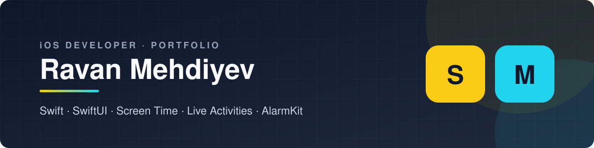

 

Native iOS apps I design and build, from product idea to App Store–ready release.

[**Scrollary**](#-scrollary) &nbsp;•&nbsp; [**MedCall**](#-medcall) &nbsp;•&nbsp; [**Tech Stack**](#-tech-stack) &nbsp;•&nbsp; [**Certificates**](https://github.com/iosravandev/certificates) &nbsp;•&nbsp; [**Website**](https://iosravandev.github.io/portfolio/)

---

## 📚 Scrollary

> **Earn your screen time by learning vocabulary.**

Scrollary blocks the apps you choose, such as Instagram or TikTok, using Apple's Screen Time. To unlock them, you scroll a TikTok-style feed of vocabulary cards. Each correct answer earns minutes of screen time. Words you miss go into **My Words**, where a Recovery Quiz pays double.

<table>
  <tr>
    <td align="center" width="20%">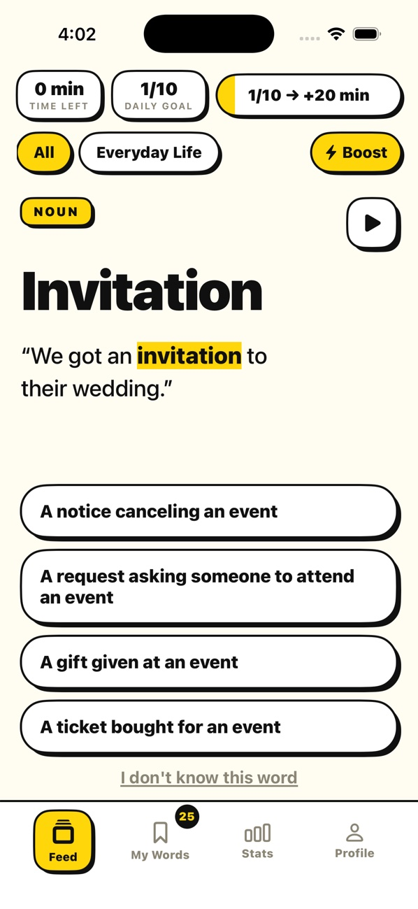 <b>Word feed</b></td>
    <td align="center" width="20%">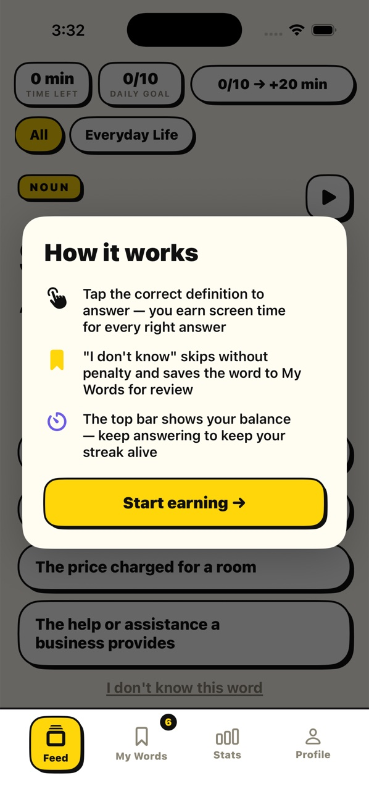 <b>How it works</b></td>
    <td align="center" width="20%">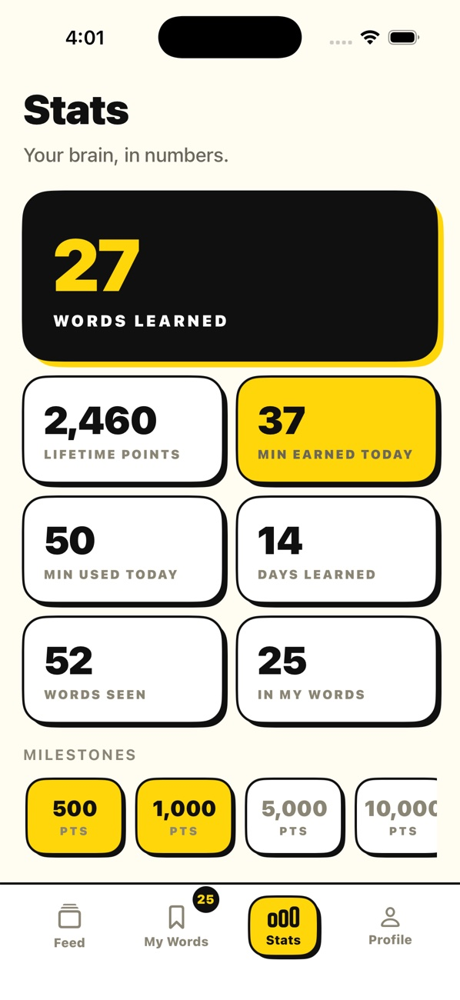 <b>Stats</b></td>
    <td align="center" width="20%">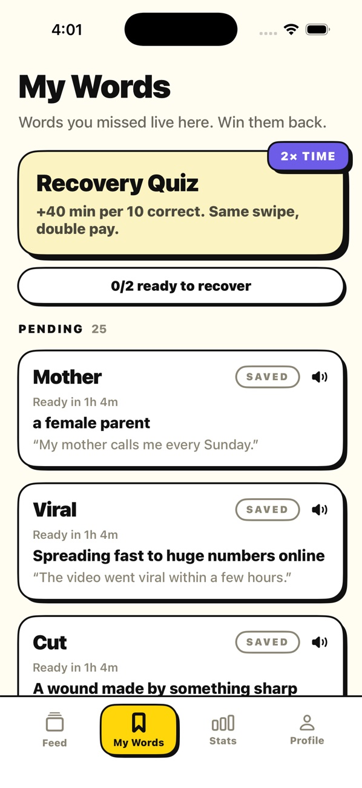 <b>My Words</b></td>
    <td align="center" width="20%">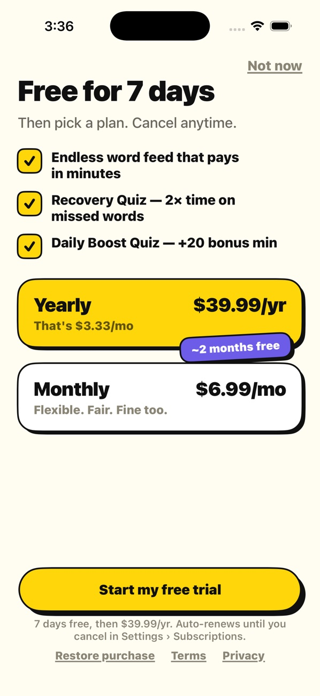 <b>Plans</b></td>
  </tr>
</table>

**Highlights**

- 🛡 **Screen Time integration**: blocks the chosen apps with the Family Controls, ManagedSettings and DeviceActivity frameworks, plus custom Shield UI and Shield Action extensions.
- 🃏 **Endless learning feed**: vertical, swipeable word cards with meaning-match and fill-in-the-blank quizzes, audio and example sentences.
- ⏱ **Time economy**: correct answers bank minutes of screen time. Boost quizzes and Recovery Quizzes (2× rewards) make reviewing worthwhile.
- 📊 **Progress & stats**: words learned, points, daily goals and milestones.
- 🔄 **Offline-first sync**: the full word catalogue is cached locally with SwiftData and kept up to date by delta sync against a NestJS REST API.
- 💳 **Subscriptions**: monthly and yearly plans with a free trial through RevenueCat. No account or login needed.

🌐 [scrollary.cloud](https://scrollary.cloud)

---

## 💊 MedCall

> **Your medication calls you, so you never miss a dose.**

Most pill reminders are notifications that get swiped away. MedCall rings like an **incoming phone call**: a full-screen alarm that sounds even in Silent mode, where you swipe to confirm you took the dose. Live Activities and widgets show your next dose at a glance.

<table>
  <tr>
    <td align="center" width="20%">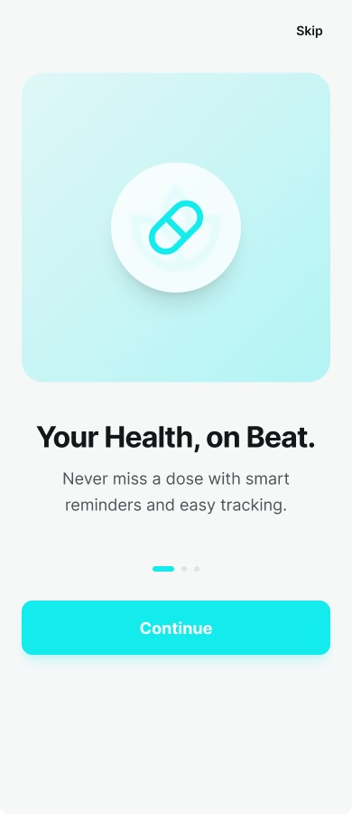 <b>Onboarding</b></td>
    <td align="center" width="20%">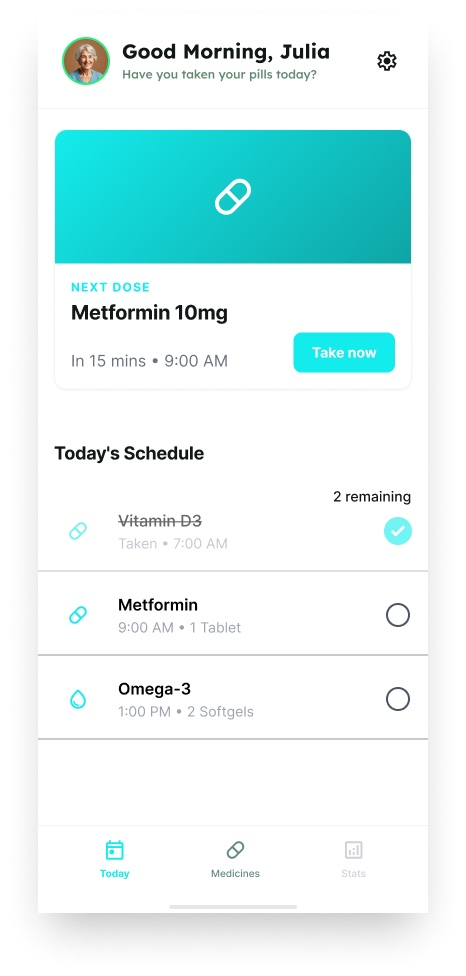 <b>Today</b></td>
    <td align="center" width="20%">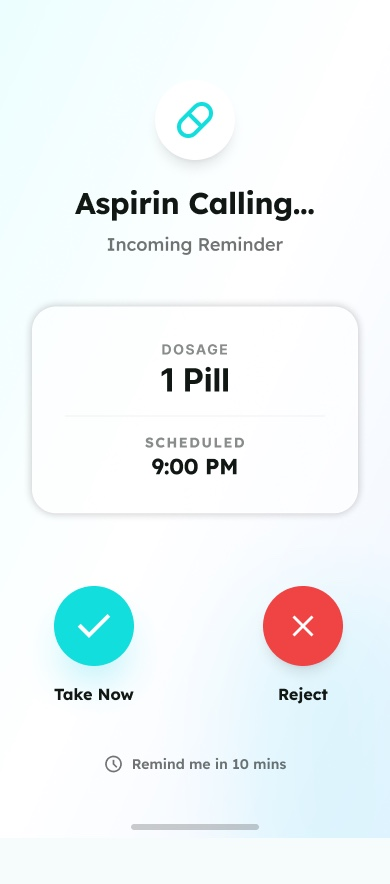 <b>Incoming call</b></td>
    <td align="center" width="20%">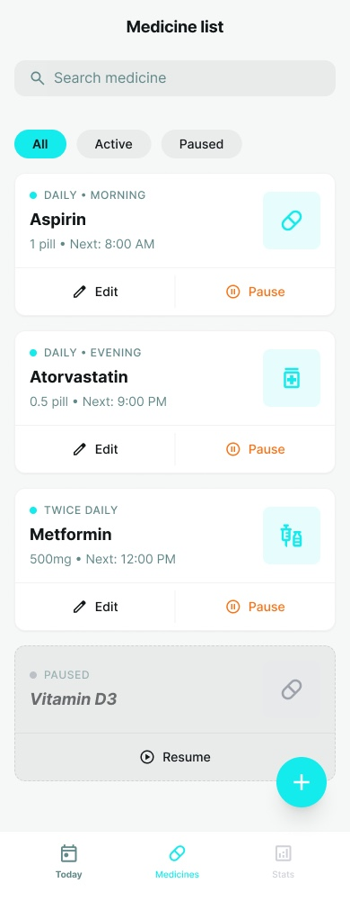 <b>Medicines</b></td>
    <td align="center" width="20%">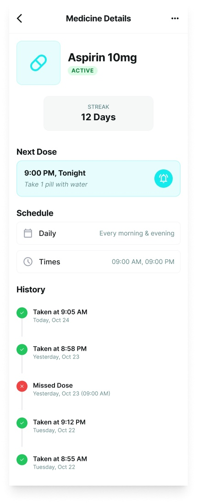 <b>Details</b></td>
  </tr>
</table>

**Highlights**

- 📞 **Call-style alarms**: full-screen, ringing reminders built on AlarmKit, with Take, Reject and Snooze actions.
- 🏝 **Live Activities & Dynamic Island**: a live countdown to the next dose on the Lock Screen and in the Dynamic Island.
- 🧩 **Home Screen widgets & controls**: next-dose and daily-progress widgets, with interactive actions through App Intents.
- 🗓 **Flexible schedules**: several doses per day, chosen weekdays, dosage amounts, notes, and pausing/resuming medicines.
- 🔥 **History & streaks**: a per-medicine log of taken and missed doses, with streak tracking.
- 🏗 **Clean architecture**: MVVM with use cases, repositories and a dependency container on top of Core Data.

---

## 🛠 Tech Stack

| Area | Technologies |
|:--|:--|
| **Language & UI** | Swift, SwiftUI, UIKit, Observation, Combine |
| **Persistence** | SwiftData, Core Data, Keychain, App Groups |
| **System integration** | Screen Time (FamilyControls, ManagedSettings, DeviceActivity), AlarmKit, ActivityKit, WidgetKit, App Intents, UserNotifications |
| **Monetization** | StoreKit, RevenueCat |
| **Architecture** | MVVM, Clean Architecture, dependency injection, offline-first sync |
| **Tooling** | Xcode, Git, XCTest / XCUITest, Claude Code |

## 📫 More

- 🎓 **Certificates:** [github.com/iosravandev/certificates](https://github.com/iosravandev/certificates)
- 💻 **GitHub:** [@iosravandev](https://github.com/iosravandev)

The source code for these apps is private. This repository shows the products, their features and the technology behind them.

